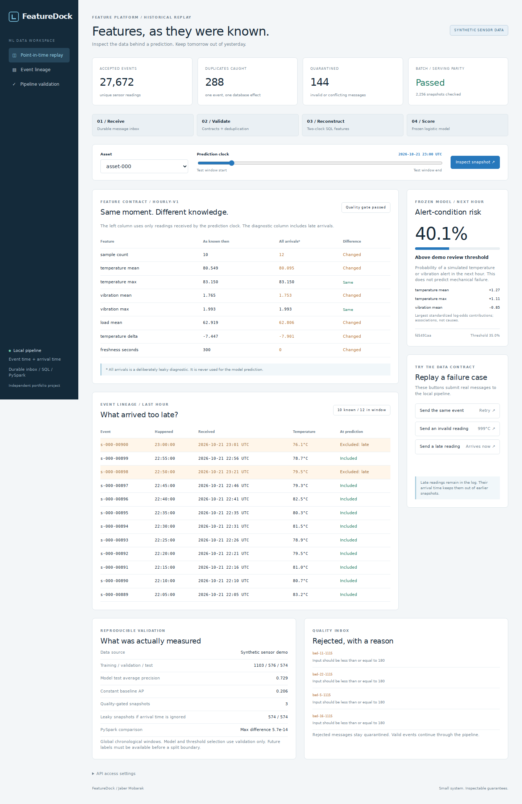

# FeatureDock

**Point-in-time ML features, with a durable event inbox and a late-arrival replay dashboard.**

A sensor reading can happen at 10:00 and arrive at 10:20. A prediction made at 10:05 must not use it. FeatureDock makes that distinction explicit, then checks that a PySpark backfill and a serving-time SQL lookup produce the same features.

The project includes a real processing pipeline, a trained logistic model, a FastAPI service, and a browser workspace. Its sensor data and alert labels are synthetic. It has not been connected to industrial equipment.



## Run locally

Python 3.11 or 3.12. No GPU, model API key, Java, or external service is needed for the default demo.

```bash
python -m venv .venv
# Windows PowerShell: .venv\Scripts\Activate.ps1
# Linux / macOS:
source .venv/bin/activate
python -m pip install -e '.[dev]'
python -m featuredock.cli demo
python -m featuredock.cli serve
```

Open **http://127.0.0.1:8020**. Windows users can run `start_windows.bat`; Linux/macOS users can run `bash start_unix.sh`.

`demo` generates the fixture, validates it, and creates the local database. It uses the included model and report when the dataset fingerprint matches. `--retrain` rebuilds the model and report. A database containing a different fixture or unrelated events is not silently overwritten; use another `--db` path.

## Try three failure cases

1. **Send the same event:** the duplicate counter increases, but the event count does not.
2. **Send an invalid reading:** a 999°C message is quarantined with its validation reason; other events can continue.
3. **Send a late reading:** the accepted event count increases. It appears in the lineage table, but cannot change the earlier point-in-time snapshot. The deliberately leaky diagnostic column does change.

These buttons submit messages to the database and run the actual consumer. They do not animate fabricated counters or retrain the model.

## What is implemented

| Area | Inspectable implementation |
|---|---|
| Ingestion | Durable SQLite inbox, stable message IDs, payload-aware idempotency |
| Quality | Strict field/range checks, conflicting-event quarantine, reasons retained |
| Recovery | Event write and inbox progress committed in the same transaction |
| Features | Indexed SQL lookup using both event time and receipt time |
| Batch processing | Actual PySpark SQL join/aggregations, Parquet write and reread |
| Consistency | Independent Spark and SQLite aggregations compared across historical anchors |
| ML | Training-only scaling, logistic candidates, validation selection and threshold, untouched test window |
| Serving | FastAPI contracts, quality-gated predictions, data-only JSON model artifact |
| Inspection | Historical clock, feature comparison, event lineage, coefficient contributions and quarantine log |
| Delivery | Behavior tests, CI, readiness checks, metrics, Docker configuration |

This is a small single-database feature pipeline. It does not claim distributed stream processing, a Kafka deployment, an online feature cache, or high-load performance.

## Executed results

The release fixture contains 24 assets over 96 virtual hours:

| Pipeline check | Measured result |
|---|---:|
| Accepted unique readings | 27,672 |
| Duplicate messages suppressed | 288 |
| Invalid messages quarantined | 144 |
| Readings received over 15 minutes late | 3,309 |
| PySpark snapshots compared | 2,256 |
| Feature values compared | 18,048 |
| Maximum Spark/SQL absolute difference | 5.68 × 10⁻¹⁴ |
| Null/quality-gate mismatches | 0 |

These are release measurements from an executed local Spark 3.5.4 job using Java 17 and `local[2]`. The dashboard reads that report; it does not start Spark on each request. Added probe messages change the live inbox counts while the release benchmark remains fixed.

The model's target is **any simulated temperature above 82°C or vibration above 2.15 during the following hour**. This is an illustrative future alert condition, not a validated mechanical-failure label.

| Final test metric | Logistic model | Constant training-prevalence baseline |
|---|---:|---:|
| Average precision | 0.7292 | 0.2056 |
| ROC-AUC | 0.8492 | 0.5000 |
| Brier score, lower is better | 0.1006 | 0.1633 |

There are 574 usable test snapshots; 20.6% have positive labels. Three snapshots across the complete fixture fail the quality gate and are excluded from fitting/evaluation. Ignoring receipt time changes features in all 574 test snapshots. That diagnostic establishes a data difference, not a quantified accuracy improvement or business benefit.

Exact counts, cutoffs, model settings, dataset fingerprint, selected threshold, and Spark comparison are in [`artifacts/report.json`](artifacts/report.json).

## Reproduce the Spark backfill

Install Java 17 and the optional Spark dependency:

```bash
python -m pip install -e '.[dev,spark]'
python -m featuredock.cli demo --retrain --spark
FD_RUN_SPARK=1 python -m pytest -q
```

On PowerShell, set `$env:FD_RUN_SPARK='1'` before running pytest. `python -m featuredock.cli spark-check` reruns only the Spark comparison for the current demo configuration. Parquet output is written under `runtime/spark-features/`.

Spark runs locally with two worker threads. The fixture is loaded through Python before the Spark join; this is not a distributed ingestion benchmark. The job writes aggregated snapshot statistics to Parquet and verifies the row count after rereading it. No throughput or cluster-scale claim is made.

## Time and feature contract

For a prediction timestamp `t`, a reading is eligible only when:

- `event_at > t − 7200` and `event_at <= t`;
- `received_at <= t`.

The current hour is `(t − 3600, t]`; the previous hour is `(t − 7200, t − 3600]`. Features are current count, temperature mean/max, vibration mean/max, load mean, temperature change against the previous hour, and age of the latest known reading. At least six readings in each hour and freshness no worse than 15 minutes are required. Missing/insufficient history produces abstention.

The server assigns receipt time for API ingestion. Clients cannot backdate it. The seeded replay loader is a trusted historical-import path: its generated receipt timestamps describe a virtual historical clock. It is intentionally separate from the live ingestion contract.

Labels become available one hour after each prediction anchor. Split membership requires label availability by the boundary, preventing training on outcomes that were still unknown. Scaling uses training data only. Regularization and the review threshold are chosen on validation. Scoring refuses timestamps before the model's selection cutoff. Training latency is not modeled at that cutoff.

The model is frozen; the test period does not refit it. Neighboring snapshots are correlated and assets recur across windows. This measures temporal generalization within the simulator, not performance on unseen real equipment. The simulator and thresholds were chosen in advance; no real-world effectiveness or statistical-significance claim is made.

## API

Interactive schema: `/docs`. Liveness: `/health`. Readiness: `/ready`. Persisted queue/event gauges: `/metrics`.

```bash
curl 'http://127.0.0.1:8020/api/config'
curl 'http://127.0.0.1:8020/api/summary'
```

Take an asset ID and a test-window timestamp from `/api/config`, then call `/api/snapshot?asset_id=ASSET&at=UTC_EPOCH_SECONDS`.

To ingest your own event shape:

```json
{
  "messages": [{
    "message_id": "delivery-0001",
    "payload": {
      "event_id": "reading-0001",
      "asset_id": "asset-000",
      "event_at": 1792500000,
      "temperature": 63.5,
      "vibration": 1.2,
      "load": 55.0
    }
  }]
}
```

POST this object to `/api/ingest`, then POST `/api/process` to consume up to 1,000 pending messages. `python -m featuredock.cli worker` drains the queue and exits. It is not a background daemon or broker consumer. Raw message ingestion is separate from event acceptance: a schema-invalid payload can be enqueued and then quarantined. Reusing a message ID with different content returns 409; the entire enqueue batch rolls back.

Imported real sensor data is outside the model's validated domain. Keep sensitive data private and retrain/evaluate with an appropriate target before interpreting predictions. The sample model only demonstrates the pipeline.

## Recovery and operating boundary

Within one SQLite database, validation, event insertion/deduplication, and inbox progress share a transaction. A crash before commit rolls everything back; a retry can safely resume. Tests simulate that crash and concurrent workers. This is exactly-once **database effects**, not a guarantee of distributed exactly-once delivery.

WAL, indexed lookups and a busy timeout support the small local workload. History is retained; there is no watermark eviction, automatic retention, multi-tenant isolation, or external queue. Feature lookup reads event history rather than a materialized online cache.

| Variable | Default |
|---|---|
| `FD_DB` | `runtime/events.db` |
| `FD_ARTIFACTS` | `artifacts` |
| `FD_API_TOKEN` | empty; set to require bearer access on data routes and metrics |

The default server and Compose port bind to localhost. A token can be entered under dashboard API access settings; it remains in page memory. Health, readiness and API schema remain public. The shared token is not user identity. External deployment needs TLS, authorization, bounded request bodies, rate limits, retention and backup policies, and operational monitoring.

```bash
python -m pytest -q
python -m ruff check .
python -m ruff format --check .
docker compose up --build
```

The Python application, browser workflow, and real Spark backfill were executed. Docker configuration is supplied but was not executed in the development environment. CI separately checks Python 3.11/3.12 and the Spark path with Java 17.

[Architecture](docs/ARCHITECTURE.md) · [Interview walkthrough](docs/INTERVIEW_GUIDE.md) · [Русский запуск](README_RU.md)

Author: Jaber Mobarak. MIT license. Developed with AI assistance; inspect and reproduce the implementation before presenting it as evidence of your skills.
