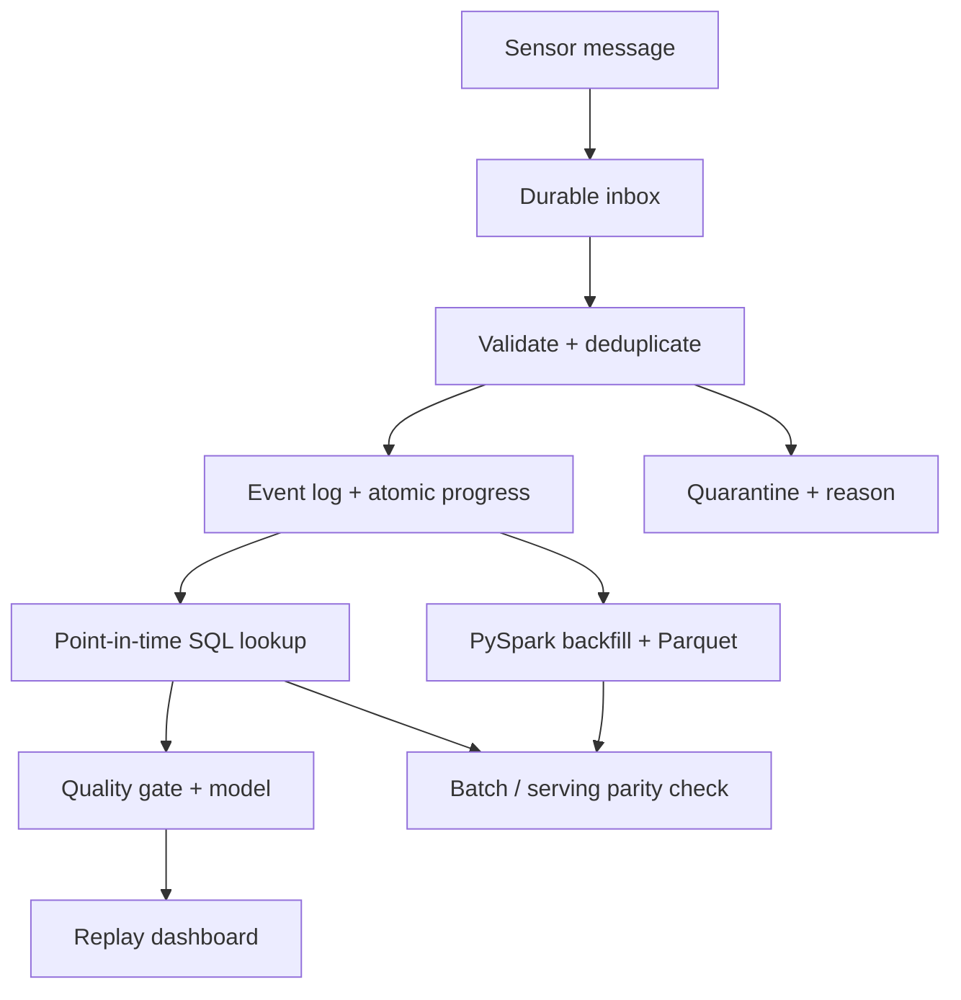

# Architecture

## Ingestion and recovery

Two identities serve different purposes. `message_id` identifies an inbox delivery. `event_id` identifies a sensor observation. The same message with unchanged content is an enqueue no-op; conflicting content rejects and rolls back the batch. Distinct message IDs can deliver the same event. The consumer compares normalized event payloads, marks a retry as duplicate, or quarantines a conflicting event.

`BEGIN IMMEDIATE` obtains the write lock before duplicate checks. Event writes and inbox status updates commit together. The consumer's before-commit fault hook lets tests prove that neither survives an interrupted transaction. Each operation creates and closes its own connection; SQL uses parameters for data values.

Schema errors are quarantined per message instead of aborting unrelated records. Receipt time remains the first observed time; a retry cannot move an observation earlier or later. Invalid JSON is outside the HTTP envelope contract and receives a request validation error. Valid JSON with invalid event fields can enter the inbox and is quarantined by the worker.

## Two clocks

Event time describes when a measurement happened. Receipt time describes when the application knew it. Both must be no later than the prediction timestamp. Late arrivals are retained, so historical snapshots remain reproducible. Ignoring the receipt clock is exposed only as a deliberately incorrect diagnostic.

This version queries indexed event history for each feature request. It has no watermark, eviction scheme or online cache. It trades scale for inspectability and a short correctness argument. Keep receipt time trustworthy when replacing the fixture importer or introducing another ingestion source.

## Independent batch path

Serving SQL uses conditional aggregates against SQLite. The batch path executes a PySpark SQL left join from prediction anchors to observations with the same eligibility boundaries. They share the feature-name and quality-gate contract but perform aggregation independently. Tests with hand-calculated boundary cases reduce the chance of both implementations agreeing on the same semantic mistake.

The Spark result is written and reread as Parquet. The comparison includes numerical values, nulls and quality-gate decisions. Floating-point summation order can differ; the tolerance is 1e-9.

## Model

Standardized logistic regression forecasts a future threshold crossing in synthetic measurements. Candidate regularization values and an F1-based review threshold are selected on validation only. Weights, scaler statistics, feature order, cutoffs and threshold are serialized as JSON and checksummed; loading does not execute pickle. The data fingerprint identifies the generated fixture. Predictions expose standardized log-odds contributions; these are coefficients applied to inputs, not SHAP values or causal effects.

The model is a consumer of the feature platform, not the project's main novelty. There is no retraining loop. The replay time must be after the declared model-availability cutoff, and the feature quality gate may abstain.

## Next engineering steps

A real deployment would need independently sourced labels, explicit delayed-label policies, measured data volumes, retention, access controls, and monitoring. A broker, scheduler, shared warehouse, or online cache should follow those requirements and profiling. None is claimed by the local inbox implementation.
